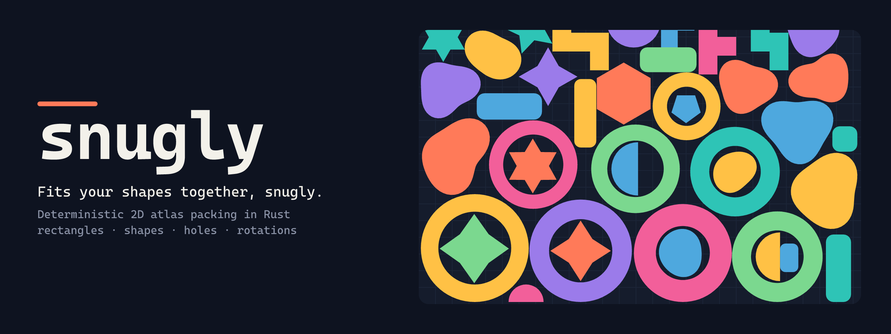

# snugly



*Fits your shapes together, snugly.*

Deterministic 2D atlas packing for rectangles and irregular shapes, in pure safe Rust
(`#![forbid(unsafe_code)]`).

- **Rectangles** (`pack_rects`, `pack_rects_strip`): sprite sheets, texture aggregation,
  impostor frames, light-map pages. Padding and 90° rotations are supported.
- **Irregular shapes** (`pack`): UV charts or any outline, built from triangles, a raster mask
  or a rectangle. Shapes interlock, can go under each other's overhangs, and with
  `nest_in_holes` can go inside each other's holes. Quarter-turn rotations are supported.
- **Deterministic**: the output depends only on the input, never on thread count, CPU or the
  `parallel` feature. Work runs in parallel with rayon, and ties are broken by a fixed order.
- **Small**: depends only on `glam` (plus `rayon` and `serde` behind features). Builds for
  `wasm32-unknown-unknown`.

## Usage

```rust
use snugly::{pack, pack_rects_strip, ChartMask, PackOptions};

// Rectangles: lowest strip 1024 px wide, 2 px padding, rotations allowed.
let sizes = [(120, 40), (64, 64), (30, 200)];
let (placements, height) = pack_rects_strip(&sizes, 1024, 2, true).unwrap();

// Rectangles into a fixed atlas (None if they don't fit).
let fixed = snugly::pack_rects(&sizes, 512, 512, 2, true);

// Errors say what went wrong.
match snugly::pack_rects_strip(&[(300, 300)], 256, 0, false) {
    Err(snugly::PackError::TooWide { index, .. }) => assert_eq!(index, 0),
    _ => unreachable!(),
}

// Irregular shapes: per-triangle footprints (UV charts, in pixels), 2 px padding.
let tris = vec![[glam::Vec2::new(0.0, 0.0), glam::Vec2::new(90.0, 0.0), glam::Vec2::new(0.0, 60.0)]];
let shapes = vec![ChartMask::from_triangles(&tris, 90, 60, 2), ChartMask::rect(32, 32)];
let packing = pack(&shapes, &PackOptions::width(256).with_max_height(512)).unwrap();
for p in &packing.placements {
    // p.x, p.y: offset of the shape's frame after p.rotation quarter turns (CCW);
    // map shape-frame points with snugly::rotate_point.
}
```

`cargo run -p snugly --example pack_shapes` packs a few rectangles and shapes and prints
the atlas as ASCII.

## Features

| feature | default | effect |
|---|---|---|
| `parallel` | on | Runs the packers, rule variants and position searches on rayon's pool. Turn it off (`default-features = false`) for WASM, single-threaded hosts or to avoid rayon: same output, slower on multi-core machines |
| `serde` | off | `Serialize` / `Deserialize` for `PackOptions`, `HoleFill` and `Placement` |

Minimum supported Rust version: **1.99** (edition 2024).

## Options (`PackOptions`)

| field | default | meaning |
|---|---|---|
| `width` | — | atlas width in pixels |
| `max_height` | `None` | fail rather than grow taller |
| `rotations` | `true` | allow quarter turns |
| `fill_holes` | `Auto` | also run the hole-filling packer (`Auto`: ≤ 32 shapes) |
| `nest_in_holes` | `false` | let shapes go inside holes of other shapes |

`nest_in_holes` is off by default. UV charts mostly have sliver holes, and handing those back
as free space only fragments it. On a water bottle atlas, utilization went from 0.626 to 0.601
with it on. Turn it on for shapes with real holes: frames, rings, decals with cut-outs.

## How it works

- **Rectangles: MaxRects plus skyline, best of many.** The free space is kept as the list of
  maximal empty rectangles (Jylänki 2010). Five placement rules (bottom-left, best short
  side, contact, best area, best long side) are combined with five input orders (longest side,
  area, perimeter, height, width). With rotations on, each pair also runs without rotations, so
  turning rotations on never makes the packing worse. All variants run in parallel, along with
  a skyline packer, and the lowest packing wins. `pack_rects_strip` binary-searches the atlas
  height between the area bound and the skyline's height. `pack` uses this path when every
  shape is a full rectangle.
- **Irregular shapes: outlines, not bitmaps.** A shape is stored as its per-column and per-row
  covered extents, computed straight from the triangles with conservative rasterization and
  square dilation for padding. The pixel mask is never built.
  - The skyline packer drops each shape, largest first and over four rotations, where its lower
    outline wastes the least area.
  - The hole-filling packer keeps free intervals per column, so space under overhangs, and
    inside holes with `nest_in_holes`, stays usable. It ranks positions with a cheap lower bound
    (every fourth column) and checks them exactly in that order, stopping early (branch and
    bound).
  - The shapes' bounding rectangles also go through the rectangle packers. That wins when
    there are many nearly rectangular shapes (a lantern atlas went from 0.707 to 0.738). Only
    heights below the outline packers' result are searched, and the search is skipped when the
    rectangles' total area already rules that out.
  - All packers run and the lowest atlas wins.

Placement is bottom-left search over outlines and free intervals. snugly does not use
FFT or cross-correlation placement (US 12,112,510 B2).

## Benchmarks

`bench-compare pack` (in the farthing repo, where snugly started) gives every packer the same rectangles, sorted
longest side first, and a fixed atlas width. It reports the lowest height each packer fits
(fixed-size packers by binary search on the height); utilization = rectangle area ÷ atlas area.
Measured with 4 rayon threads (snugly only; the others are single-threaded).

| dataset | snugly | crunch 0.5 | rectangle-pack 0.4 | guillotiere 0.7 | etagere 0.3 |
|---|---|---|---|---|---|
| 500 uniform 8–64 px, 1024 wide | **0.981** | 0.962 | 0.928 | 0.943 | 0.764 |
| 300 sprites 16–256 px, 2048 wide | **0.980** | 0.966 | 0.872 | 0.929 | 0.778 |
| 200 bars 1:3–1:25, 1024 wide | **0.965** | 0.899 | 0.611 | 0.847 | 0.655 |
| 24 large 48–512 px, 1024 wide | **0.921** | 0.873 | 0.784 | 0.678 | 0.567 |
| 24 frames 256² + 40 props, 2048 wide | **0.978** | 0.974 | 0.954 | 0.954 | 0.775 |

Rotations are on for snugly and crunch (crunch's better of with and without);
rectangle-pack, guillotiere and etagere don't rotate. etagere and guillotiere are dynamic
allocators built for speed and deallocation (under 3 ms here), not for density. snugly's
strip search takes 3–190 ms on these sets, comparable to crunch's single-threaded 0.5–170 ms.
The full table, with timings, is in the farthing repo's `docs/BENCHMARKS.md`.

For UV charts, farthing-uv with this packer reaches higher utilization than xatlas on all 8
glTF sample assets at 1024², 2 px padding: Fox 0.634 vs 0.547, water bottle 0.659 vs 0.640,
DamagedHelmet 0.610 vs 0.470.

## Versioning

Semantic versioning, read the pre-1.0 way: in 0.x, a minor bump (0.1 → 0.2) may break the
API and a patch bump never does.

- **API.** `PackOptions` may gain fields in minor versions, always with a default. Build it
  with `PackOptions::width` plus the `with_*` methods, or `..PackOptions::width(w)`, and your
  code keeps compiling. `Placement`, `MaskPlacement`, `Packing`, `HoleFill` and `PackError` are
  `#[non_exhaustive]`.
- **Output.** For the same input, a patch release produces the same placements. A minor
  release may change them when packing gets tighter, and the changelog says so. Determinism
  across threads, CPUs and the `parallel` feature never changes. A golden test pins the output
  of a fixed workload, and CI runs it with and without `parallel`.
- **MSRV.** Raising the minimum Rust version is a minor-version change.

## License

[MIT-0](LICENSE-MIT0) (MIT No Attribution): use it for anything, no attribution required.
